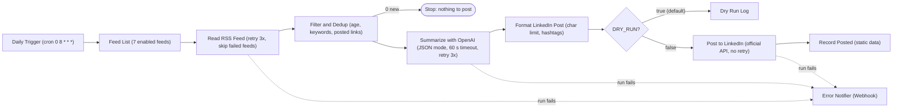

# AI News Summarizer + LinkedIn Publisher

An n8n workflow that reads tech and business RSS feeds, picks fresh and relevant articles, summarizes them
with an LLM (OpenAI Chat Completions) and publishes the result to LinkedIn through LinkedIn's official API.
It runs in dry-run mode by default, never posts the same link twice, and sends an alert when a run fails.

Built in 2025; hardened in 2026 with a rebuilt workflow on supported n8n nodes, de-duplication, a dry-run
gate, retries and timeouts, an error workflow, a workflow validator, tests, a pinned Docker setup and CI.

## What it does



| File | Purpose |
| --- | --- |
| `workflows/ai-news-summarizer-production.json` | Main workflow |
| `workflows/error-notifier.json` | Error workflow: posts a redacted failure summary to a Slack/Discord-style webhook |
| `config/news-sources.json` | Feeds (enabled flags) and keyword filters, embedded in the workflow |
| `config/prompts.json` | Summarization system prompt, embedded in the workflow |
| `config/linkedin-templates.json` | Reference post formats and hashtag sets |
| `tools/validate_workflows.py` | Static checks for workflow JSON |

## Setup in 5 steps

Prerequisites: Docker with the Compose plugin, an OpenAI API key, and a LinkedIn developer app with the
*Share on LinkedIn* product. Full details are in [docs/setup-guide.md](docs/setup-guide.md).

1. **Prepare the environment**: `./scripts/setup.sh` creates `.env` from `.env.example` with
   `DRY_RUN=true` and a random `N8N_ENCRYPTION_KEY`, then validates the workflows.
2. **Start n8n**: `docker compose up -d`, open http://localhost:5678 and create the owner account.
3. **Add credentials** in n8n: *OpenAI* named `OpenAI account`, and *LinkedIn OAuth2 API* named
   `LinkedIn account` (Client ID and Secret from your LinkedIn app, then *Connect*).
4. **Import**: `docker compose exec n8n n8n import:workflow --separate --input=/workflows`. Select the
   credentials and your LinkedIn profile on the nodes, and set *Settings, Error workflow* to
   `Error Notifier (Webhook)`.
5. **Dry run, then go live**: execute once and review the *Dry Run Log* output. When it looks right, set
   `DRY_RUN=false`, run `docker compose up -d` and activate the workflow.

## Configuration

| Variable | Default | Purpose |
| --- | --- | --- |
| `N8N_ENCRYPTION_KEY` | none (required) | Encrypts n8n credentials; keep it stable |
| `GENERIC_TIMEZONE` | `UTC` | Timezone of the 08:00 schedule |
| `N8N_BLOCK_ENV_ACCESS_IN_NODE` | `false` | Must be `false`: the workflows read the settings below via `$env` |
| `DRY_RUN` | `true` | Anything except `false` logs the post instead of publishing it |
| `MAX_POSTS_PER_RUN` | `1` | Maximum posts published per run |
| `LINKEDIN_CHAR_LIMIT` | `3000` | Post length cap; the summary is trimmed to fit |
| `MIN_ARTICLE_AGE_HOURS` / `MAX_ARTICLE_AGE_HOURS` | `1` / `48` | Age window for articles |
| `OPENAI_MODEL` | `gpt-4o-mini` | Chat Completions model |
| `ALERT_WEBHOOK_URL` | empty | Slack/Discord-style incoming webhook for failure alerts; empty disables alerts |

API keys and OAuth secrets are never in `.env` or in the workflow JSON; they live in n8n's encrypted
credential store. The validator fails CI if a secret, personal e-mail address or undocumented `$env`
variable appears in a workflow.

## Reliability features

- **Dry run by default**: a fresh install publishes nothing until `DRY_RUN=false` is set.
- **De-duplication**: links are canonicalized (tracking parameters and fragments removed) and checked
  against the last 1,000 posted links in workflow static data. A link is recorded only after LinkedIn
  accepts the post, so failed posts are retried on the next run.
- **No duplicate posts on retry**: the LinkedIn node is deliberately not retried, because a retry after
  a timed-out but successful request would publish twice.
- **Retries and timeouts**: feeds are retried 3 times and then skipped so one dead feed does not stop
  the run; the OpenAI call has a 60 s timeout and 3 retries; the whole run is capped at 10 minutes.
- **Guarded LLM output**: the model is asked for JSON (`response_format: json_object`); an answer without
  a valid summary is skipped, never published. Hashtags are sanitized and capped at 3.
- **Failure alerts**: the error workflow sends workflow name, node and error message to a webhook, with
  API keys and bearer tokens redacted.
- **Tests**: pytest covers the validator (with a deliberately broken fixture), the consistency between the
  workflow and `config/`, and the Code-node JavaScript, run under Node.js with a small n8n stand-in.

## Development

```bash
python3 -m venv .venv && . .venv/bin/activate
pip install -r requirements-dev.txt
python tools/validate_workflows.py workflows --env-example .env.example
pytest                      # Code-node tests need Node.js; they are skipped without it
shellcheck scripts/*.sh
./scripts/test-workflow.sh  # live check of enabled feeds (and OPENAI_API_KEY if set)
```

CI (`.github/workflows/ci.yml`) runs the same checks, plus a JSON lint and `docker compose config`.

## LinkedIn API and terms

Posting goes only through LinkedIn's official API, using n8n's LinkedIn node and an OAuth app you create.
There is no scraping or browser automation. You are responsible for following
[LinkedIn's API Terms of Use](https://www.linkedin.com/legal/l/api-terms-of-use) and the rules of the
products your app is approved for, including any limits on automated posting. Keep `MAX_POSTS_PER_RUN`
low, review dry-run output before going live, and make sure each post credits its source (the workflow
always includes the article link).

## Limitations

- n8n saves static data only for production executions (active workflow, started by its trigger).
  Manual runs with `DRY_RUN=false` can post a link again.
- The posted-link history lives in the n8n database; it is lost if the `n8n_data` volume is deleted or
  the workflow is re-imported as a new workflow.
- Feeds, keywords and the system prompt are copied from `config/` into the workflow, not read at runtime;
  a test keeps them in sync. `config/linkedin-templates.json` is not used by the workflow.
- Summaries are generated from the RSS snippet, not the full article, so they are only as good as the
  feed's description. Review dry-run output before enabling posting.
- The error workflow has to be linked by hand after import (workflow IDs differ per instance).
- The workflow JSON targets n8n 2.x and is checked statically in CI; CI does not import it into a
  running n8n instance.
- The weekly newsletter workflow from the 2025 version was removed because it could not run; it is
  still in git history.
